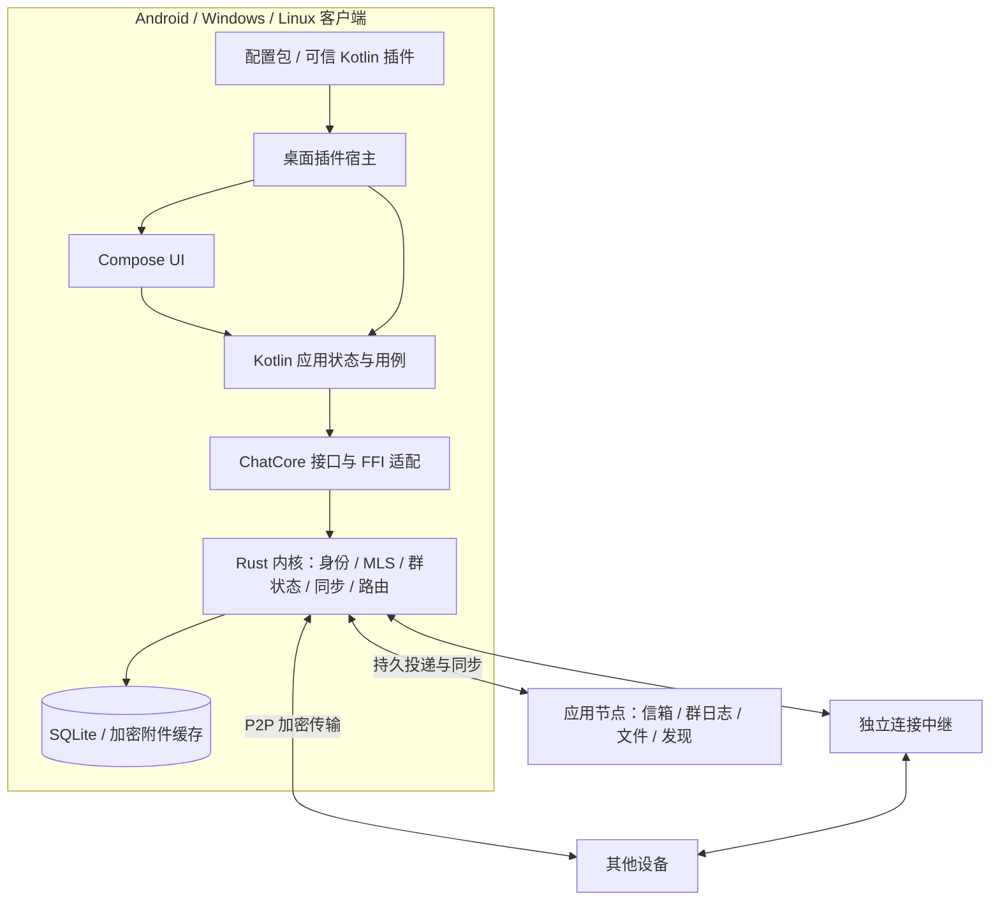

# 跨平台加密聊天软件完整架构设计

版本：0.1 · 2026-10-18 · 设计提案

## 1. 目标、假设与约束

目标平台是 Android、Windows、Linux。界面及应用状态使用 Kotlin，提供私聊、小群、文件传输、用户自行配置扩展、自托管节点和 P2P 直连。

设计采用本地优先：消息与待发送操作先在设备落盘，再尝试同步。设备身份独立于服务端地址；服务节点只接触密文及必要的路由、权限元数据。直连、连接中继、离线信箱是三个独立能力。

假设先由个人或小团队开发，首版面向可信联系人和邀请制群组。MVP 性能验证基线为一个群不超过 20 个账户、40 台设备；一个账户最多 2 台设备。这里的数值是产品范围和验证目标，不是已经测得的容量。

主要约束：

- Android 后台不保证持续联网，可靠离线消息需要在线信箱。
- Compose Desktop 使用 JVM，不能预设极低内存或安装包体积。
- 使用成熟加密协议，但身份授权、持久化、群治理和恢复流程仍由应用设计。
- 可信 JVM 插件具有应用级能力；API 权限提示不能约束恶意 JVM 代码。
- 群协调节点故障时，MVP 暂停正式消息确认和群管理操作，以保持一致的权限语义。

## 2. 技术决策

| 范围 | 选择 | 理由及限制 |
|---|---|---|
| 三端 UI | Kotlin + Compose Multiplatform | 共享 UI 和状态，平台通知及后台行为单独适配 |
| UI 状态 | Coroutines + Flow | 单向状态流，界面不直接持有协议对象 |
| 协议内核 | Rust | 统一网络、MLS 状态、事务与消息同步，避免三端协议差异 |
| Kotlin/Rust 边界 | UniFFI 或等价生成绑定 | 以业务方法和回调跨边界；需要真实构建验证 |
| 传输 | iroh / QUIC | 直连、穿透、中继；不代替消息层协议 |
| E2EE | MLS / OpenMLS | 私聊与群聊统一建模；必须先验证 Android 和持久化 |
| 客户端存储 | SQLite，敏感记录加密存储 | 由 Rust 内核唯一拥有；系统密钥库保护存储主密钥 |
| 服务端 | Rust 模块化单体 | 小部署使用一个应用进程，复用公共协议类型 |
| 自托管 | 应用节点 + 可选独立 iroh relay | 中继不是离线消息服务器 |
| 桌面插件 | 配置包 + 可信 Kotlin/JVM 插件 | SDK 与生命周期先落地；Wasm 沙箱后续加入 |
| 大型基础设施 | 暂不采用 | MVP 不依赖 Kafka、Redis、Kubernetes 或全网共享数据库 |

这些选择是建议，不代表 Kotlin 不能实现网络与服务端。增加 Rust 是为了集中复用所选网络和加密库，同时接受原生构建与 FFI 的维护成本。

## 3. 总体结构与依赖方向



依赖规则：

1. UI → 应用层 → 核心接口 → FFI → Rust 内核。
2. Rust 协议类型与领域规则不依赖 UI、插件或服务端框架。
3. 加密层不依赖连接选择；同一条消息密文可以通过不同路径投递。
4. 服务节点复用协议与公共权限校验，不加载客户端身份私钥。
5. 插件 SDK 不暴露数据库句柄、MLS 对象或密钥导出接口。此规则是公共 API 约束，不能作为可信 JVM 插件的安全隔离。
6. 原生线程通过事件桥接更新 Flow；不得直接调用 Compose 或阻塞 UI 线程。

## 4. 建议项目目录

```text
chat/
├─ README.md
├─ settings.gradle.kts
├─ build.gradle.kts
├─ gradle/libs.versions.toml
├─ Cargo.toml                         # Rust workspace
├─ Cargo.lock
├─ docs/
│  ├─ design/                         # 本设计包
│  ├─ adr/                            # 后续架构决策记录
│  └─ protocol/                       # 线协议、版本、测试向量
├─ apps/
│  ├─ android/                        # Android 入口、通知、生命周期
│  ├─ desktop/                        # Windows/Linux 入口、托盘、安装包
│  └─ node/                           # Rust 应用节点可执行程序
├─ shared/
│  ├─ ui/                             # commonMain：共享 Compose UI
│  ├─ presentation/                   # commonMain：页面状态、用例、Flow
│  ├─ core-api/                       # commonMain：业务接口与 DTO
│  ├─ core-bridge/                    # Android/JVM：生成绑定与映射
│  └─ platform-api/                   # 密钥保护、通知、文件选择等接口
├─ crates/
│  ├─ protocol/                       # 版本化线协议和标识符
│  ├─ domain/                         # 群权限、状态机、不变量
│  ├─ identity/                       # 账户、设备凭据、邀请、撤销
│  ├─ crypto/                         # OpenMLS 封装与附件加密
│  ├─ storage/                        # SQLite、迁移、事务、敏感记录保护
│  ├─ transport/                      # iroh、节点 HTTPS/WebSocket 适配
│  ├─ sync/                           # outbox/inbox、游标、重试、去重
│  ├─ core/                           # 客户端内核编排
│  ├─ ffi/                            # 有限的导出方法、回调、错误映射
│  ├─ node-services/                  # 信箱、群排序、文件、发现
│  └─ node-api/                       # HTTP/WS 鉴权、请求限制、管理接口
├─ desktop/
│  ├─ plugin-sdk/                     # 稳定 SDK；不依赖应用内部实现
│  ├─ plugin-host/                    # 加载、注册、生命周期、故障记录
│  └─ platform/                       # Windows/Linux 系统适配
├─ plugins/
│  ├─ examples/hello-command/          # Kotlin 示例插件
│  ├─ examples/message-formatter/      # 用户选中内容处理示例
│  └─ themes/default/                 # 声明式主题示例
├─ schemas/
│  ├─ plugin-manifest.schema.json
│  └─ message-types/                  # 结构化内容类型与文本回退规范
├─ tests/
│  ├─ protocol/                       # 互操作及畸形输入
│  ├─ integration/                    # 客户端/节点端到端测试
│  ├─ recovery/                       # 崩溃、状态回滚、断线补齐
│  └─ fixtures/                       # 无真实私钥的测试数据
├─ deploy/
│  ├─ compose.yaml                    # 应用节点及可选中继
│  ├─ node.example.toml
│  └─ relay/                          # 中继部署示例
└─ tools/
   ├─ bindings/                       # 生成并检查 Kotlin 绑定
   └─ packaging/                      # 三端安装包与原生库打包
```

目录是逻辑边界。第一版可以将紧密相关的 Rust 模块放在较少 crate 内，避免大量空壳工程；稳定后再拆分。项目树并不意味着每个目录都是独立服务。

Android 与 Desktop 的共同 UI 和 DTO 放在 commonMain；JNI/JNA/UniFFI 等实现位于平台 source set。iroh 的 Kotlin 绑定是 JVM 绑定，不能直接假设可从 commonMain 使用。

## 5. 模块职责和数据所有权

| 模块 | 拥有的数据/行为 | 不负责 |
|---|---|---|
| presentation | 页面状态、导航、用户意图 | 加密状态与投递重试 |
| identity | 身份密钥引用、设备凭据、信任指纹 | 按服务器分配账户身份 |
| crypto | MLS 会话、KeyPackage、协议密钥生命周期 | 群业务角色和传输路径 |
| domain | 群角色、权限规则、消息状态转换 | 网络和 UI |
| storage | 客户端唯一数据库与迁移 | 服务端数据全量镜像 |
| sync | 持久发送队列、投递任务、游标、补齐 | 根据 UI 是否打开决定可靠性 |
| transport | 连接建立、流、回退、诊断 | 认定消息已读或合法 |
| core | 领域、加密、存储、同步的事务编排 | 插件专有 UI |
| plugin-host | 扩展点、版本检查、生命周期 | 协议正确性的最终裁决 |
| node-services | 持久信箱、群日志、密文文件、配额 | 解密正文或恢复用户密钥 |

客户端仅 Rust storage 写入核心数据库。Kotlin 使用分页查询和订阅，不创建第二份消息数据库。系统密钥库适配负责包装/解包存储主密钥；它不意味着所有 MLS 私钥都必须能直接放进硬件密钥槽。

## 6. 身份、设备与信任

账户 ID 根据规范编码后的长期身份公钥派生。显示名和服务器地址可变，不参与账户唯一标识。传输 EndpointId 与账户 ID 分开，由设备凭据将它们绑定。

MVP 账户有一个主管身份密钥和最多两台设备。新设备显示一次性二维码，已有可信设备核对并授权；设备生成自己的私钥，授权端为其设备凭据签名。账户主管密钥的本地保存、设备授权权限和恢复方式必须明确，不将“新设备证明它持有网络密钥”当成账户授权。

MVP 可由初始设备保管受系统密钥保护的账户身份密钥，第二台设备只持有自己的设备密钥；恢复文件单独备份身份密钥。初始设备丢失时，使用恢复文件授权新设备。这是首版简化，后续可以改成明确的委托授权链。

首次联系人交换通过邀请/二维码获取公钥指纹；可再次扫码验证。首次信任后凭据变化必须提示，服务端返回的新公钥不能静默覆盖已信任公钥。

撤销一台设备后，在所有相关会话中移除其加密成员并更新密钥。撤销不能删除它已经获得的消息或文件。节点替换不会改变账户 ID，但换节点的自动迁移与冗余信箱不进入 MVP。

## 7. 消息加密与本地持久化

使用 MLS，设备作为独立叶节点。私聊是双方当前获准设备组成的小型加密群；本人跨设备的私有同步通道用于设置和必要状态同步。

应用负责验证 MLS 凭据与账户、设备凭据的一致性。加群 KeyPackage 的签名、身份绑定、有效性及一次性使用状态需要验证。具体密码套件采用 OpenMLS 已支持的标准套件，经三端验证后锁定；不自行组合新的聊天加密协议。

两层保护同时存在：iroh/TLS 保护连接，MLS 保护应用消息经过节点和离线存储时的机密性。附件用随机文件密钥分块加密，文件密钥、摘要、大小和分块规则放在 E2EE 消息内。分块 nonce 必须唯一，并认证文件 ID、块序号和结束边界，防止替换、重排与截断。

保存消息时，必须将 MLS 状态推进、待发送密文和应用记录放入同一事务或可证明等价的恢复流程。不要假设独立数据库事务可以自然原子提交。实现前验证 OpenMLS storage provider 能否接入统一事务；不能时采用预写日志和幂等恢复，并以断电/崩溃测试验证。

同一已生成密文的网络重试使用相同密文与事件 ID；不得恢复旧密钥状态再重新加密。需要因新 epoch 重新发送未接受的草稿时，按新加密状态生成新尝试，并保留本地草稿与最终事件的对应关系。

本地 SQLite 中敏感记录与附件缓存加密；索引同样视为敏感数据。首版只提供受限本地搜索，不上传明文索引。日志默认不写正文、私钥或密钥材料。

新设备默认只能读取加入后的新消息。MVP 不做旧历史自动导入；账户恢复文件也不是聊天历史备份。未来历史导出使用独立备份密钥，并明确长期保存历史会改变历史数据的保密边界。

## 8. 网络、离线投递与消息状态

设备连接路径为局域网/已知地址直连 → 公网穿透 → 连接中继。离线时投递到收件设备已授权的节点信箱，信箱按配额与 TTL 持久保存。

发现记录由设备签名，带有效期和记录版本。MVP 采用二维码邀请、节点发现和地址缓存；公开 DHT、自动联邦及多节点副本后续实现。

消息走至少一次投递：用加密认证后的事件 ID 去重，并对密文尝试 ID 去重，抵御重复投递与确认丢失。外部消息 ID 不能直接作为可信去重依据。应用数据库实现一次有效插入；不承诺网络恰好一次。

建议用户状态：

| 状态 | 精确定义 |
|---|---|
| 待发送 | 草稿和发送意图已在本机持久化 |
| 已接受 | 群协调节点接受正式事件；私聊沿用同一协调会话模型 |
| 已送达 | 至少一台对方获准设备完成验证并持久化 |
| 已读 | 对方明确发送的已读事件；MVP 可暂不实现 |
| 发送失败 | 可操作错误，如被禁言、设备撤销、附件超限 |

界面可显示“信箱已存储”，但不能据此显示“已送达”。群聊送达状态保留每设备、每账户明细，默认 UI 显示已送达账户数量；本人其他设备不计入对方送达数量。

传输 ACK、信箱 ACK 和端到端送达回执分开。回执本身经认证，且不会再生成回执，避免无限确认。核心事件订阅允许丢失临时 UI 通知，可靠性由持久游标和重新查询保证。

## 9. 群聊设计：协调模式作为第一版

### 9.1 状态分层

- 业务群：GroupId、成员账户、群主/管理员/成员、群设置。
- 加密群：当前设备成员、MLS epoch、验证过的密钥状态。
- 投递群：协调节点、顺序日志、接收设备信箱和拉取游标。

GroupId 与 CoordinatorId 独立。MVP 每个会话固定一个协调节点，私聊也沿用相同基础设施。组内显示名、正文、公告等放在密文中；路由、设备成员、角色变更和必要授权元数据可对协调节点可见，以便排序、限流和粗粒度拒绝。这个元数据泄漏是明确取舍。

### 9.2 有序事件日志

每群拥有单调递增的 group_seq。普通消息、成员/角色变更、发言权限变化都进入同一日志。节点接受事件时为其返回绑定内容摘要、序号和前一日志摘要的签名回执。加密控制事件还引用预期 control_head、业务策略版本和 MLS epoch。

客户端不是盲目信任回执：它验证作者身份、角色规则、控制事件前置条件、MLS 状态及结果成员集合。节点能拒绝、延迟或分叉日志，但不能因此获得明文或伪造合法成员的加密身份。MVP 检测到不连续、摘要冲突或非法状态时停止应用该分支，提示同步故障并重新拉取；不承诺对恶意节点的自动容错。

更新群策略与 MLS 成员的控制批次必须在客户端和节点逻辑上完整落盘。一个控制事件只描述一种受允许的操作；管理员不能借加人操作夹带任命群主等未授权变化。客户端应用前验证控制元数据与 MLS Commit 的实际结果一致。

### 9.3 P2P 与一致性

P2P 可预传密文、附件和已经确认的日志条目。尚未获得节点回执的事件只作为待确认消息，不触发自动回复、机器人或共享插件的正式状态变化。收件方按正式日志补齐并处理，避免不同端各自决定禁言后的消息是否有效。

节点拒绝旧 control_head/epoch 的提交时，发送方先同步已接受的控制事件，再根据新状态重新构造合法提交。并发 MLS Commit 不直接合并；由协调节点按前置状态选定一个，其余回退到新的已确认状态后重新提案。这里的回退是清理未接受的 pending 操作，不能回滚已消耗的密码学状态。

缺失控制事件时先补控制日志，不直接跳到新 epoch 解密。新成员通过合法 Welcome 加入；长期离线且无法补齐的设备通过当前成员授权重新加入，不从服务器获取明文群密钥。

协调节点离线时，MVP 允许本地写草稿和保存发送意图，但不正式接受新消息、变更成员或宣称禁言已经生效。自由 P2P 群与自动协调者故障转移是后续独立协议，不隐藏在“最终一致”一词中。

### 9.4 权限规则

| 操作 | 群主 | 管理员 | 成员 |
|---|---|---|---|
| 发消息 | 是 | 是 | 未被禁言时 |
| 邀请普通成员 | 是 | 是 | MVP 默认否 |
| 移除普通成员 | 是 | 是 | 否 |
| 任免管理员 | 是 | 否 | 否 |
| 禁言普通成员 | 是 | 是 | 否 |
| 转让群主 | 是 | 否 | 否 |
| 推荐群插件 | 是 | 是 | 否 |
| 强制在他人设备安装插件 | 否 | 否 | 否 |

移除账户时必须移除其全部当前设备；新增或撤销设备也需要更新相关群的设备成员集合。群主退出前先转让所有权，或明确解散群。MVP 不提供频道、匿名管理、大型社区或复杂权限表达式。

### 9.5 扩展的群数据

共享功能使用版本化结构事件：feature namespace、schema version、operation ID、object ID、payload、fallback text。事件由作者所属设备加密认证，并引用群上下文。插件产生事件，内核执行通用校验，声明为共享状态的功能另有确定的权限与状态规则。

不依赖接收方执行任意插件才能验证核心群权限。没有插件时显示文本回退，保留原始密文/受保护内容以便将来兼容读取。MVP 先支持命名空间和文本回退；投票和任务板的协作协议后续实现。

## 10. 桌面插件方案

### 10.1 第一版：配置包与可信 Kotlin 插件

主题、快捷键与资源配置通过 schema 校验加载。可信插件是 Kotlin/JVM JAR，使用 PF4J 或等价框架管理发现与生命周期，可注册命令、选中消息操作、设置项及受约束的 UI 扩展。

MVP SDK 不直接导出任意 Compose 二进制界面接口；先提供宿主绘制的设置表单、菜单和消息操作。直接挂载 Compose 面板放在后续的强版本绑定 SDK，避免首版就承受 Kotlin/Compose ABI 兼容成本。

可信插件安装时显示“具有应用级权限”。SDK 范围与权限描述便于正常插件最小化访问，但 ClassLoader 和 SDK 检查不能阻止恶意代码访问文件、网络或进程内数据。MVP 不宣称可以安全运行任意陌生 JAR。

### 10.2 包与生命周期

插件包包含 manifest.json、plugin.jar、资源及可选发布者签名。安装时验证清单、路径穿越、包大小、SDK 版本、重复 ID 和摘要。官方示例可以固定已知发布者；本地未签名插件要求明确选择可信模式。代码签名确认来源，不证明安全。

按命令/操作访问懒加载，不为每个插件常驻创建线程池。start 注册资源，stop 注销资源并取消插件作用域；实际卸载 JVM 类和遗留线程无法强制保证，所以安装升级默认下次启动生效。提供禁用、崩溃记录和不加载第三方插件的安全启动。

插件不能重写正式协议事件或在后台静默改变发件人。SDK 的发送入口始终回到正常应用用例和核心权限检查；插件事件循环设置来源标识并由正常插件避免递归。可信恶意插件仍属于被用户信任的应用代码。

### 10.3 后续沙箱

Wasm 插件只导入宿主能力，默认无网络、无任意文件、无密钥访问。实际授权细分到选中内容、指定会话、插件私有存储和特定网络域名。执行预算、线性内存、队列长度、宿主 I/O 超时和输出大小分别限制。

外部 AI/音视频工具采用独立进程 RPC，处理崩溃和超时。操作系统权限隔离需要单独实现，不能将“独立进程”当成限制文件访问的保证。

### 10.4 群插件与机器人

个人插件仅作用于安装设备。群共享功能同步协议数据和推荐插件信息，不自动下载执行代码，也不强制安装。权限和网络凭据不随群设置自动授予。

机器人是独立 E2EE 成员，可在用户常开设备或自托管节点上的独立客户端进程运行。它持有自己的设备密钥，能读取所加入群的内容；存储节点不能以普通服务端插件的名义解密聊天。MVP 不包含常驻机器人框架。

## 11. 本地与节点数据模型

客户端核心表建议：

```text
accounts, device_credentials, trusted_contacts
conversations, conversation_devices
group_policy_snapshots, group_log_entries, pending_group_operations
mls_state_records, key_packages
messages, message_attempts, receipts
outbox_jobs, inbox_dedup, sync_cursors
attachments, attachment_chunks
plugin_preferences
```

messages 是 UI 可查询的物化视图；group_log_entries 是已验证的协议事件记录。密钥状态与 pending 操作不暴露给 UI 查询。插件业务私有存储与核心库分开，可信插件仍可能绕过正常 API，这是其信任模型的一部分。

节点核心表建议：devices、signed_discovery_records、mailbox_items、groups、group_log、group_control_heads、blob_objects、blob_uploads、quotas、request_dedup。节点保留与协议恢复相关的控制日志；删除内容密文与裁剪控制日志采用不同策略，不能按同一个 TTL 盲目清理。

建议初始默认限制：单条消息序列化后不超过 64 KiB，附件不超过 25 MiB，离线信箱保留 30 天，节点允许配置更低/更高配额。它们是待测试的产品默认值；超过保留期且无其他副本的消息可能无法恢复。

## 12. 部署、后台行为与可观测性

最小部署：一个有持久磁盘的应用节点，提供 HTTPS/WSS、SQLite 和密文附件目录。需要连接兜底时增加自托管 iroh relay。二者可在同一机器的不同进程运行；配置明确替换默认公共发现/中继，验证关闭公共基础设施后仍可使用。

node API 对设备签名请求鉴权，支持邀请注册、收件箱写入授权、配额、速率限制与上传限制。发送私聊前需要联系人接受或有效邀请能力，避免开放垃圾投递。能力令牌的范围与过期时间明确，不能将账户私钥发给节点。

Android 前台维持节点事件连接和需要的 P2P 连接，后台可靠性由信箱保证。MVP 不承诺后台即时通知；恢复前台后增量同步。FCM/其他推送适配以及用户主动启用的前台服务放在后续阶段。推送仅提示有更新，不承载消息正文或密钥。

桌面支持托盘常驻、显式退出和断网重连。睡眠恢复视为连接重建，不假设原连接仍有效。数据目录、配置目录和日志目录遵守平台惯例；默认日志做敏感字段脱敏。

观察指标包括：直连/中继比例、连接失败类别、待发队列长度、投递延迟、群控制冲突、同步缺口、插件故障、数据库迁移结果。指标不包含聊天正文或原始密钥。

轻量化目标先测量再定：按 ABI 裁剪原生库，裁剪桌面运行时，插件按需加载，消息分页，附件流式处理，网络操作批量与退避。验收报告记录测试机器、版本与场景，不能以架构方案代替真实性能数据。

## 13. 版本、错误与演进

线协议、插件 SDK、数据库 schema、结构化内容 schema 分别版本化。协议握手协商必需能力；不支持的安全必需能力必须拒绝，不能静默降级。未知结构化内容可以文本回退，未知群控制操作不得跳过继续应用。

错误分类覆盖可重试网络错误、需要同步的状态冲突、权限错误、凭据撤销、协议不兼容、存储错误、数据损坏和插件不兼容。UI 展示可操作信息，开发诊断保留脱敏错误码。

服务端升级与客户端滚动升级至少验证同一协议主版本的兼容窗口。MVP 节点迁移通过人工配置和明确维护窗口进行；后续再引入经成员授权的协调者迁移、跨节点授权转发和冗余信箱。

## 14. 验证重点

测试集中于真实故障边界：加密状态崩溃恢复、重复与乱序、两名管理员并发操作、移除设备后的密钥更新、旧 epoch 提交、权限变更与消息竞争、附件损坏、节点重启、Android 恢复前台、插件 stop 后资源释放。

MVP 的恶意节点策略是验证、检测和停止错误分支，不承诺自动拜占庭容错。恶意终端可以保存其曾解密的内容；恶意可信插件等价于不可信应用代码。E2EE 不隐藏所有通信元数据，也不能撤销已泄漏内容。

## 15. 核实来源与待验证项

文档核对日期：2026-10-18。实现时应锁定依赖版本并再次检查支持矩阵。

- [Compose 支持平台与版本](https://kotlinlang.org/docs/multiplatform/compose-compatibility-and-versioning.html)：Android、Windows、Linux 可共用 Compose 技术栈；具体 ABI 支持不能从 UI 框架推断到全部依赖。
- [iroh 传输能力](https://docs.rs/iroh/latest/iroh/) 与 [Kotlin 绑定](https://docs.iroh.computer/languages/kotlin)：Kotlin/JVM 可用，Android 及目标原生库需按文档自行构建和验证；不是 commonMain 的纯 Kotlin 库。
- [iroh 自托管中继](https://docs.iroh.computer/add-a-relay)：连接中继可以自行部署；仍需自建应用信箱和群协调服务。
- [MLS RFC 9420](https://www.rfc-editor.org/rfc/rfc9420.html)：群密钥建立与协议安全性质；业务权限和服务可用性不是 MLS 自动提供的能力。
- [OpenMLS 支持矩阵](https://github.com/openmls/openmls)：Android 构建目标和实际运行测试等级存在区别，需补充真机验证。
- [OpenMLS 成员授权](https://book.openmls.tech/user_manual/add_members.html)：应用需要定义授权策略。
- [PF4J 类加载](https://pf4j.org/doc/class-loading.html)：独立 ClassLoader 用于插件类与依赖管理，不能推出安全隔离。
- [Wasmtime 执行与资源限制](https://docs.wasmtime.dev/api/wasmtime/struct.Config.html)：Wasm 预算、内存和宿主调用需要分别处理。
- [Android Doze 与后台联网](https://developer.android.com/training/monitoring-device-state/doze-standby)：后台实时性需平台适配，不对所有设备作无条件保证。

阻断正式开发扩展范围的验证项：三端 FFI/原生库打包、Android OpenMLS 真机运行、统一事务/崩溃恢复、跨端 MLS 互操作、受限网络下自托管连接。任何一项失败都应先修复或记录明确替代决策，再继续增加功能。
