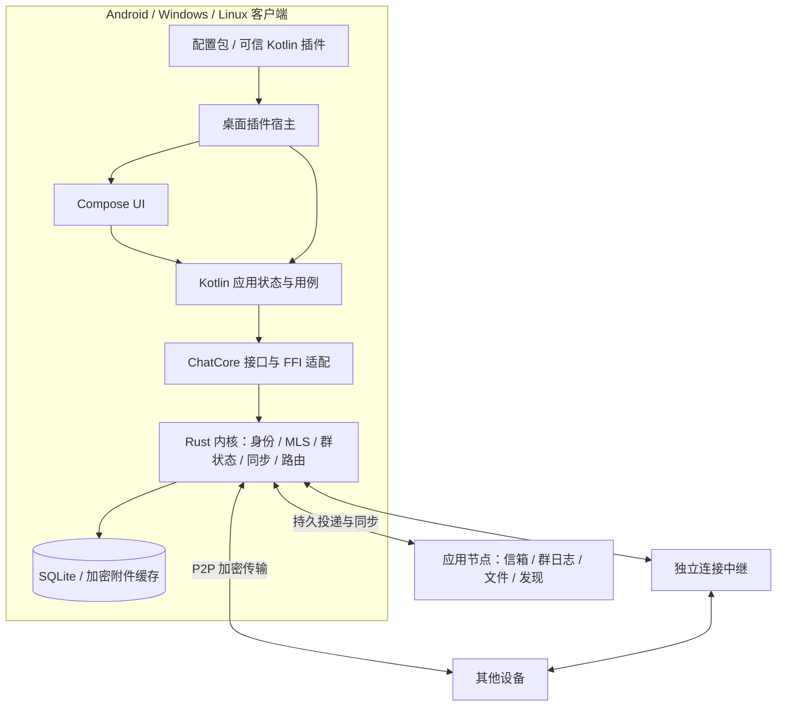

# 跨平台加密聊天软件：完整架构设计（合并版）

日期：2026-10-18。状态：设计提案，尚未实现。本文件合并架构、接口、MVP 与对话要点，便于保存到项目文件夹。

---

# 跨平台加密聊天软件完整架构设计

版本：0.1 · 2026-10-18 · 设计提案

## 1. 目标、假设与约束

目标平台是 Android、Windows、Linux。界面及应用状态使用 Kotlin，提供私聊、小群、文件传输、用户自行配置扩展、自托管节点和 P2P 直连。

设计采用本地优先：消息与待发送操作先在设备落盘，再尝试同步。设备身份独立于服务端地址；服务节点只接触密文及必要的路由、权限元数据。直连、连接中继、离线信箱是三个独立能力。

假设先由个人或小团队开发，首版面向可信联系人和邀请制群组。MVP 性能验证基线为一个群不超过 20 个账户、40 台设备；一个账户最多 2 台设备。这里的数值是产品范围和验证目标，不是已经测得的容量。

主要约束：

- Android 后台不保证持续联网，可靠离线消息需要在线信箱。
- Compose Desktop 使用 JVM，不能预设极低内存或安装包体积。
- 使用成熟加密协议，但身份授权、持久化、群治理和恢复流程仍由应用设计。
- 可信 JVM 插件具有应用级能力；API 权限提示不能约束恶意 JVM 代码。
- 群协调节点故障时，MVP 暂停正式消息确认和群管理操作，以保持一致的权限语义。

## 2. 技术决策

| 范围 | 选择 | 理由及限制 |
|---|---|---|
| 三端 UI | Kotlin + Compose Multiplatform | 共享 UI 和状态，平台通知及后台行为单独适配 |
| UI 状态 | Coroutines + Flow | 单向状态流，界面不直接持有协议对象 |
| 协议内核 | Rust | 统一网络、MLS 状态、事务与消息同步，避免三端协议差异 |
| Kotlin/Rust 边界 | UniFFI 或等价生成绑定 | 以业务方法和回调跨边界；需要真实构建验证 |
| 传输 | iroh / QUIC | 直连、穿透、中继；不代替消息层协议 |
| E2EE | MLS / OpenMLS | 私聊与群聊统一建模；必须先验证 Android 和持久化 |
| 客户端存储 | SQLite，敏感记录加密存储 | 由 Rust 内核唯一拥有；系统密钥库保护存储主密钥 |
| 服务端 | Rust 模块化单体 | 小部署使用一个应用进程，复用公共协议类型 |
| 自托管 | 应用节点 + 可选独立 iroh relay | 中继不是离线消息服务器 |
| 桌面插件 | 配置包 + 可信 Kotlin/JVM 插件 | SDK 与生命周期先落地；Wasm 沙箱后续加入 |
| 大型基础设施 | 暂不采用 | MVP 不依赖 Kafka、Redis、Kubernetes 或全网共享数据库 |

这些选择是建议，不代表 Kotlin 不能实现网络与服务端。增加 Rust 是为了集中复用所选网络和加密库，同时接受原生构建与 FFI 的维护成本。

## 3. 总体结构与依赖方向



依赖规则：

1. UI → 应用层 → 核心接口 → FFI → Rust 内核。
2. Rust 协议类型与领域规则不依赖 UI、插件或服务端框架。
3. 加密层不依赖连接选择；同一条消息密文可以通过不同路径投递。
4. 服务节点复用协议与公共权限校验，不加载客户端身份私钥。
5. 插件 SDK 不暴露数据库句柄、MLS 对象或密钥导出接口。此规则是公共 API 约束，不能作为可信 JVM 插件的安全隔离。
6. 原生线程通过事件桥接更新 Flow；不得直接调用 Compose 或阻塞 UI 线程。

## 4. 建议项目目录

```text
chat/
├─ README.md
├─ settings.gradle.kts
├─ build.gradle.kts
├─ gradle/libs.versions.toml
├─ Cargo.toml                         # Rust workspace
├─ Cargo.lock
├─ docs/
│  ├─ design/                         # 本设计包
│  ├─ adr/                            # 后续架构决策记录
│  └─ protocol/                       # 线协议、版本、测试向量
├─ apps/
│  ├─ android/                        # Android 入口、通知、生命周期
│  ├─ desktop/                        # Windows/Linux 入口、托盘、安装包
│  └─ node/                           # Rust 应用节点可执行程序
├─ shared/
│  ├─ ui/                             # commonMain：共享 Compose UI
│  ├─ presentation/                   # commonMain：页面状态、用例、Flow
│  ├─ core-api/                       # commonMain：业务接口与 DTO
│  ├─ core-bridge/                    # Android/JVM：生成绑定与映射
│  └─ platform-api/                   # 密钥保护、通知、文件选择等接口
├─ crates/
│  ├─ protocol/                       # 版本化线协议和标识符
│  ├─ domain/                         # 群权限、状态机、不变量
│  ├─ identity/                       # 账户、设备凭据、邀请、撤销
│  ├─ crypto/                         # OpenMLS 封装与附件加密
│  ├─ storage/                        # SQLite、迁移、事务、敏感记录保护
│  ├─ transport/                      # iroh、节点 HTTPS/WebSocket 适配
│  ├─ sync/                           # outbox/inbox、游标、重试、去重
│  ├─ core/                           # 客户端内核编排
│  ├─ ffi/                            # 有限的导出方法、回调、错误映射
│  ├─ node-services/                  # 信箱、群排序、文件、发现
│  └─ node-api/                       # HTTP/WS 鉴权、请求限制、管理接口
├─ desktop/
│  ├─ plugin-sdk/                     # 稳定 SDK；不依赖应用内部实现
│  ├─ plugin-host/                    # 加载、注册、生命周期、故障记录
│  └─ platform/                       # Windows/Linux 系统适配
├─ plugins/
│  ├─ examples/hello-command/          # Kotlin 示例插件
│  ├─ examples/message-formatter/      # 用户选中内容处理示例
│  └─ themes/default/                 # 声明式主题示例
├─ schemas/
│  ├─ plugin-manifest.schema.json
│  └─ message-types/                  # 结构化内容类型与文本回退规范
├─ tests/
│  ├─ protocol/                       # 互操作及畸形输入
│  ├─ integration/                    # 客户端/节点端到端测试
│  ├─ recovery/                       # 崩溃、状态回滚、断线补齐
│  └─ fixtures/                       # 无真实私钥的测试数据
├─ deploy/
│  ├─ compose.yaml                    # 应用节点及可选中继
│  ├─ node.example.toml
│  └─ relay/                          # 中继部署示例
└─ tools/
   ├─ bindings/                       # 生成并检查 Kotlin 绑定
   └─ packaging/                      # 三端安装包与原生库打包
```

目录是逻辑边界。第一版可以将紧密相关的 Rust 模块放在较少 crate 内，避免大量空壳工程；稳定后再拆分。项目树并不意味着每个目录都是独立服务。

Android 与 Desktop 的共同 UI 和 DTO 放在 commonMain；JNI/JNA/UniFFI 等实现位于平台 source set。iroh 的 Kotlin 绑定是 JVM 绑定，不能直接假设可从 commonMain 使用。

## 5. 模块职责和数据所有权

| 模块 | 拥有的数据/行为 | 不负责 |
|---|---|---|
| presentation | 页面状态、导航、用户意图 | 加密状态与投递重试 |
| identity | 身份密钥引用、设备凭据、信任指纹 | 按服务器分配账户身份 |
| crypto | MLS 会话、KeyPackage、协议密钥生命周期 | 群业务角色和传输路径 |
| domain | 群角色、权限规则、消息状态转换 | 网络和 UI |
| storage | 客户端唯一数据库与迁移 | 服务端数据全量镜像 |
| sync | 持久发送队列、投递任务、游标、补齐 | 根据 UI 是否打开决定可靠性 |
| transport | 连接建立、流、回退、诊断 | 认定消息已读或合法 |
| core | 领域、加密、存储、同步的事务编排 | 插件专有 UI |
| plugin-host | 扩展点、版本检查、生命周期 | 协议正确性的最终裁决 |
| node-services | 持久信箱、群日志、密文文件、配额 | 解密正文或恢复用户密钥 |

客户端仅 Rust storage 写入核心数据库。Kotlin 使用分页查询和订阅，不创建第二份消息数据库。系统密钥库适配负责包装/解包存储主密钥；它不意味着所有 MLS 私钥都必须能直接放进硬件密钥槽。

## 6. 身份、设备与信任

账户 ID 根据规范编码后的长期身份公钥派生。显示名和服务器地址可变，不参与账户唯一标识。传输 EndpointId 与账户 ID 分开，由设备凭据将它们绑定。

MVP 账户有一个主管身份密钥和最多两台设备。新设备显示一次性二维码，已有可信设备核对并授权；设备生成自己的私钥，授权端为其设备凭据签名。账户主管密钥的本地保存、设备授权权限和恢复方式必须明确，不将“新设备证明它持有网络密钥”当成账户授权。

MVP 可由初始设备保管受系统密钥保护的账户身份密钥，第二台设备只持有自己的设备密钥；恢复文件单独备份身份密钥。初始设备丢失时，使用恢复文件授权新设备。这是首版简化，后续可以改成明确的委托授权链。

首次联系人交换通过邀请/二维码获取公钥指纹；可再次扫码验证。首次信任后凭据变化必须提示，服务端返回的新公钥不能静默覆盖已信任公钥。

撤销一台设备后，在所有相关会话中移除其加密成员并更新密钥。撤销不能删除它已经获得的消息或文件。节点替换不会改变账户 ID，但换节点的自动迁移与冗余信箱不进入 MVP。

## 7. 消息加密与本地持久化

使用 MLS，设备作为独立叶节点。私聊是双方当前获准设备组成的小型加密群；本人跨设备的私有同步通道用于设置和必要状态同步。

应用负责验证 MLS 凭据与账户、设备凭据的一致性。加群 KeyPackage 的签名、身份绑定、有效性及一次性使用状态需要验证。具体密码套件采用 OpenMLS 已支持的标准套件，经三端验证后锁定；不自行组合新的聊天加密协议。

两层保护同时存在：iroh/TLS 保护连接，MLS 保护应用消息经过节点和离线存储时的机密性。附件用随机文件密钥分块加密，文件密钥、摘要、大小和分块规则放在 E2EE 消息内。分块 nonce 必须唯一，并认证文件 ID、块序号和结束边界，防止替换、重排与截断。

保存消息时，必须将 MLS 状态推进、待发送密文和应用记录放入同一事务或可证明等价的恢复流程。不要假设独立数据库事务可以自然原子提交。实现前验证 OpenMLS storage provider 能否接入统一事务；不能时采用预写日志和幂等恢复，并以断电/崩溃测试验证。

同一已生成密文的网络重试使用相同密文与事件 ID；不得恢复旧密钥状态再重新加密。需要因新 epoch 重新发送未接受的草稿时，按新加密状态生成新尝试，并保留本地草稿与最终事件的对应关系。

本地 SQLite 中敏感记录与附件缓存加密；索引同样视为敏感数据。首版只提供受限本地搜索，不上传明文索引。日志默认不写正文、私钥或密钥材料。

新设备默认只能读取加入后的新消息。MVP 不做旧历史自动导入；账户恢复文件也不是聊天历史备份。未来历史导出使用独立备份密钥，并明确长期保存历史会改变历史数据的保密边界。

## 8. 网络、离线投递与消息状态

设备连接路径为局域网/已知地址直连 → 公网穿透 → 连接中继。离线时投递到收件设备已授权的节点信箱，信箱按配额与 TTL 持久保存。

发现记录由设备签名，带有效期和记录版本。MVP 采用二维码邀请、节点发现和地址缓存；公开 DHT、自动联邦及多节点副本后续实现。

消息走至少一次投递：用加密认证后的事件 ID 去重，并对密文尝试 ID 去重，抵御重复投递与确认丢失。外部消息 ID 不能直接作为可信去重依据。应用数据库实现一次有效插入；不承诺网络恰好一次。

建议用户状态：

| 状态 | 精确定义 |
|---|---|
| 待发送 | 草稿和发送意图已在本机持久化 |
| 已接受 | 群协调节点接受正式事件；私聊沿用同一协调会话模型 |
| 已送达 | 至少一台对方获准设备完成验证并持久化 |
| 已读 | 对方明确发送的已读事件；MVP 可暂不实现 |
| 发送失败 | 可操作错误，如被禁言、设备撤销、附件超限 |

界面可显示“信箱已存储”，但不能据此显示“已送达”。群聊送达状态保留每设备、每账户明细，默认 UI 显示已送达账户数量；本人其他设备不计入对方送达数量。

传输 ACK、信箱 ACK 和端到端送达回执分开。回执本身经认证，且不会再生成回执，避免无限确认。核心事件订阅允许丢失临时 UI 通知，可靠性由持久游标和重新查询保证。

## 9. 群聊设计：协调模式作为第一版

### 9.1 状态分层

- 业务群：GroupId、成员账户、群主/管理员/成员、群设置。
- 加密群：当前设备成员、MLS epoch、验证过的密钥状态。
- 投递群：协调节点、顺序日志、接收设备信箱和拉取游标。

GroupId 与 CoordinatorId 独立。MVP 每个会话固定一个协调节点，私聊也沿用相同基础设施。组内显示名、正文、公告等放在密文中；路由、设备成员、角色变更和必要授权元数据可对协调节点可见，以便排序、限流和粗粒度拒绝。这个元数据泄漏是明确取舍。

### 9.2 有序事件日志

每群拥有单调递增的 group_seq。普通消息、成员/角色变更、发言权限变化都进入同一日志。节点接受事件时为其返回绑定内容摘要、序号和前一日志摘要的签名回执。加密控制事件还引用预期 control_head、业务策略版本和 MLS epoch。

客户端不是盲目信任回执：它验证作者身份、角色规则、控制事件前置条件、MLS 状态及结果成员集合。节点能拒绝、延迟或分叉日志，但不能因此获得明文或伪造合法成员的加密身份。MVP 检测到不连续、摘要冲突或非法状态时停止应用该分支，提示同步故障并重新拉取；不承诺对恶意节点的自动容错。

更新群策略与 MLS 成员的控制批次必须在客户端和节点逻辑上完整落盘。一个控制事件只描述一种受允许的操作；管理员不能借加人操作夹带任命群主等未授权变化。客户端应用前验证控制元数据与 MLS Commit 的实际结果一致。

### 9.3 P2P 与一致性

P2P 可预传密文、附件和已经确认的日志条目。尚未获得节点回执的事件只作为待确认消息，不触发自动回复、机器人或共享插件的正式状态变化。收件方按正式日志补齐并处理，避免不同端各自决定禁言后的消息是否有效。

节点拒绝旧 control_head/epoch 的提交时，发送方先同步已接受的控制事件，再根据新状态重新构造合法提交。并发 MLS Commit 不直接合并；由协调节点按前置状态选定一个，其余回退到新的已确认状态后重新提案。这里的回退是清理未接受的 pending 操作，不能回滚已消耗的密码学状态。

缺失控制事件时先补控制日志，不直接跳到新 epoch 解密。新成员通过合法 Welcome 加入；长期离线且无法补齐的设备通过当前成员授权重新加入，不从服务器获取明文群密钥。

协调节点离线时，MVP 允许本地写草稿和保存发送意图，但不正式接受新消息、变更成员或宣称禁言已经生效。自由 P2P 群与自动协调者故障转移是后续独立协议，不隐藏在“最终一致”一词中。

### 9.4 权限规则

| 操作 | 群主 | 管理员 | 成员 |
|---|---|---|---|
| 发消息 | 是 | 是 | 未被禁言时 |
| 邀请普通成员 | 是 | 是 | MVP 默认否 |
| 移除普通成员 | 是 | 是 | 否 |
| 任免管理员 | 是 | 否 | 否 |
| 禁言普通成员 | 是 | 是 | 否 |
| 转让群主 | 是 | 否 | 否 |
| 推荐群插件 | 是 | 是 | 否 |
| 强制在他人设备安装插件 | 否 | 否 | 否 |

移除账户时必须移除其全部当前设备；新增或撤销设备也需要更新相关群的设备成员集合。群主退出前先转让所有权，或明确解散群。MVP 不提供频道、匿名管理、大型社区或复杂权限表达式。

### 9.5 扩展的群数据

共享功能使用版本化结构事件：feature namespace、schema version、operation ID、object ID、payload、fallback text。事件由作者所属设备加密认证，并引用群上下文。插件产生事件，内核执行通用校验，声明为共享状态的功能另有确定的权限与状态规则。

不依赖接收方执行任意插件才能验证核心群权限。没有插件时显示文本回退，保留原始密文/受保护内容以便将来兼容读取。MVP 先支持命名空间和文本回退；投票和任务板的协作协议后续实现。

## 10. 桌面插件方案

### 10.1 第一版：配置包与可信 Kotlin 插件

主题、快捷键与资源配置通过 schema 校验加载。可信插件是 Kotlin/JVM JAR，使用 PF4J 或等价框架管理发现与生命周期，可注册命令、选中消息操作、设置项及受约束的 UI 扩展。

MVP SDK 不直接导出任意 Compose 二进制界面接口；先提供宿主绘制的设置表单、菜单和消息操作。直接挂载 Compose 面板放在后续的强版本绑定 SDK，避免首版就承受 Kotlin/Compose ABI 兼容成本。

可信插件安装时显示“具有应用级权限”。SDK 范围与权限描述便于正常插件最小化访问，但 ClassLoader 和 SDK 检查不能阻止恶意代码访问文件、网络或进程内数据。MVP 不宣称可以安全运行任意陌生 JAR。

### 10.2 包与生命周期

插件包包含 manifest.json、plugin.jar、资源及可选发布者签名。安装时验证清单、路径穿越、包大小、SDK 版本、重复 ID 和摘要。官方示例可以固定已知发布者；本地未签名插件要求明确选择可信模式。代码签名确认来源，不证明安全。

按命令/操作访问懒加载，不为每个插件常驻创建线程池。start 注册资源，stop 注销资源并取消插件作用域；实际卸载 JVM 类和遗留线程无法强制保证，所以安装升级默认下次启动生效。提供禁用、崩溃记录和不加载第三方插件的安全启动。

插件不能重写正式协议事件或在后台静默改变发件人。SDK 的发送入口始终回到正常应用用例和核心权限检查；插件事件循环设置来源标识并由正常插件避免递归。可信恶意插件仍属于被用户信任的应用代码。

### 10.3 后续沙箱

Wasm 插件只导入宿主能力，默认无网络、无任意文件、无密钥访问。实际授权细分到选中内容、指定会话、插件私有存储和特定网络域名。执行预算、线性内存、队列长度、宿主 I/O 超时和输出大小分别限制。

外部 AI/音视频工具采用独立进程 RPC，处理崩溃和超时。操作系统权限隔离需要单独实现，不能将“独立进程”当成限制文件访问的保证。

### 10.4 群插件与机器人

个人插件仅作用于安装设备。群共享功能同步协议数据和推荐插件信息，不自动下载执行代码，也不强制安装。权限和网络凭据不随群设置自动授予。

机器人是独立 E2EE 成员，可在用户常开设备或自托管节点上的独立客户端进程运行。它持有自己的设备密钥，能读取所加入群的内容；存储节点不能以普通服务端插件的名义解密聊天。MVP 不包含常驻机器人框架。

## 11. 本地与节点数据模型

客户端核心表建议：

```text
accounts, device_credentials, trusted_contacts
conversations, conversation_devices
group_policy_snapshots, group_log_entries, pending_group_operations
mls_state_records, key_packages
messages, message_attempts, receipts
outbox_jobs, inbox_dedup, sync_cursors
attachments, attachment_chunks
plugin_preferences
```

messages 是 UI 可查询的物化视图；group_log_entries 是已验证的协议事件记录。密钥状态与 pending 操作不暴露给 UI 查询。插件业务私有存储与核心库分开，可信插件仍可能绕过正常 API，这是其信任模型的一部分。

节点核心表建议：devices、signed_discovery_records、mailbox_items、groups、group_log、group_control_heads、blob_objects、blob_uploads、quotas、request_dedup。节点保留与协议恢复相关的控制日志；删除内容密文与裁剪控制日志采用不同策略，不能按同一个 TTL 盲目清理。

建议初始默认限制：单条消息序列化后不超过 64 KiB，附件不超过 25 MiB，离线信箱保留 30 天，节点允许配置更低/更高配额。它们是待测试的产品默认值；超过保留期且无其他副本的消息可能无法恢复。

## 12. 部署、后台行为与可观测性

最小部署：一个有持久磁盘的应用节点，提供 HTTPS/WSS、SQLite 和密文附件目录。需要连接兜底时增加自托管 iroh relay。二者可在同一机器的不同进程运行；配置明确替换默认公共发现/中继，验证关闭公共基础设施后仍可使用。

node API 对设备签名请求鉴权，支持邀请注册、收件箱写入授权、配额、速率限制与上传限制。发送私聊前需要联系人接受或有效邀请能力，避免开放垃圾投递。能力令牌的范围与过期时间明确，不能将账户私钥发给节点。

Android 前台维持节点事件连接和需要的 P2P 连接，后台可靠性由信箱保证。MVP 不承诺后台即时通知；恢复前台后增量同步。FCM/其他推送适配以及用户主动启用的前台服务放在后续阶段。推送仅提示有更新，不承载消息正文或密钥。

桌面支持托盘常驻、显式退出和断网重连。睡眠恢复视为连接重建，不假设原连接仍有效。数据目录、配置目录和日志目录遵守平台惯例；默认日志做敏感字段脱敏。

观察指标包括：直连/中继比例、连接失败类别、待发队列长度、投递延迟、群控制冲突、同步缺口、插件故障、数据库迁移结果。指标不包含聊天正文或原始密钥。

轻量化目标先测量再定：按 ABI 裁剪原生库，裁剪桌面运行时，插件按需加载，消息分页，附件流式处理，网络操作批量与退避。验收报告记录测试机器、版本与场景，不能以架构方案代替真实性能数据。

## 13. 版本、错误与演进

线协议、插件 SDK、数据库 schema、结构化内容 schema 分别版本化。协议握手协商必需能力；不支持的安全必需能力必须拒绝，不能静默降级。未知结构化内容可以文本回退，未知群控制操作不得跳过继续应用。

错误分类覆盖可重试网络错误、需要同步的状态冲突、权限错误、凭据撤销、协议不兼容、存储错误、数据损坏和插件不兼容。UI 展示可操作信息，开发诊断保留脱敏错误码。

服务端升级与客户端滚动升级至少验证同一协议主版本的兼容窗口。MVP 节点迁移通过人工配置和明确维护窗口进行；后续再引入经成员授权的协调者迁移、跨节点授权转发和冗余信箱。

## 14. 验证重点

测试集中于真实故障边界：加密状态崩溃恢复、重复与乱序、两名管理员并发操作、移除设备后的密钥更新、旧 epoch 提交、权限变更与消息竞争、附件损坏、节点重启、Android 恢复前台、插件 stop 后资源释放。

MVP 的恶意节点策略是验证、检测和停止错误分支，不承诺自动拜占庭容错。恶意终端可以保存其曾解密的内容；恶意可信插件等价于不可信应用代码。E2EE 不隐藏所有通信元数据，也不能撤销已泄漏内容。

## 15. 核实来源与待验证项

文档核对日期：2026-10-18。实现时应锁定依赖版本并再次检查支持矩阵。

- [Compose 支持平台与版本](https://kotlinlang.org/docs/multiplatform/compose-compatibility-and-versioning.html)：Android、Windows、Linux 可共用 Compose 技术栈；具体 ABI 支持不能从 UI 框架推断到全部依赖。
- [iroh 传输能力](https://docs.rs/iroh/latest/iroh/) 与 [Kotlin 绑定](https://docs.iroh.computer/languages/kotlin)：Kotlin/JVM 可用，Android 及目标原生库需按文档自行构建和验证；不是 commonMain 的纯 Kotlin 库。
- [iroh 自托管中继](https://docs.iroh.computer/add-a-relay)：连接中继可以自行部署；仍需自建应用信箱和群协调服务。
- [MLS RFC 9420](https://www.rfc-editor.org/rfc/rfc9420.html)：群密钥建立与协议安全性质；业务权限和服务可用性不是 MLS 自动提供的能力。
- [OpenMLS 支持矩阵](https://github.com/openmls/openmls)：Android 构建目标和实际运行测试等级存在区别，需补充真机验证。
- [OpenMLS 成员授权](https://book.openmls.tech/user_manual/add_members.html)：应用需要定义授权策略。
- [PF4J 类加载](https://pf4j.org/doc/class-loading.html)：独立 ClassLoader 用于插件类与依赖管理，不能推出安全隔离。
- [Wasmtime 执行与资源限制](https://docs.wasmtime.dev/api/wasmtime/struct.Config.html)：Wasm 预算、内存和宿主调用需要分别处理。
- [Android Doze 与后台联网](https://developer.android.com/training/monitoring-device-state/doze-standby)：后台实时性需平台适配，不对所有设备作无条件保证。

阻断正式开发扩展范围的验证项：三端 FFI/原生库打包、Android OpenMLS 真机运行、统一事务/崩溃恢复、跨端 MLS 互操作、受限网络下自托管连接。任何一项失败都应先修复或记录明确替代决策，再继续增加功能。


---

# 核心接口与协议草案

版本：0.1 · 2026-10-18

本文件定义业务边界，代码是接口草案，不是已经编译或生成的 SDK。可省略的实现细节包括 DTO 的序列化注解、具体 FFI ABI、异常类型和完整枚举。Kotlin 接口位于 `shared/core-api`；原生导出接口和线协议各自维护，不直接将 UI DTO 当作网络格式。

## 1. 标识符与基础模型

所有 ID 在真实代码中使用独立类型，并验证长度、编码与版本。不要将任意用户输入的字符串直接当成合法身份。

```kotlin
data class AccountId(val value: String)
data class DeviceId(val value: String)
data class ConversationId(val value: String)
data class MessageId(val value: String)
data class DraftId(val value: String)
data class AttachmentId(val value: String)
data class PluginId(val value: String)
data class Cursor(val value: String)

enum class ConversationKind { DIRECT, GROUP, SELF_SYNC }
enum class GroupRole { OWNER, ADMIN, MEMBER }
enum class SendState { QUEUED, ACCEPTED, DELIVERED, FAILED }

sealed interface MessageContent {
    data class Text(val text: String) : MessageContent
    data class Attachment(
        val attachmentId: AttachmentId,
        val caption: String?
    ) : MessageContent
    data class Extension(
        val namespace: String,
        val schemaVersion: Int,
        val payload: ByteArray,
        val fallbackText: String
    ) : MessageContent
}

data class SendRequest(
    val conversationId: ConversationId,
    val clientOperationId: String,  // 每次用户意图唯一；防 UI 重复提交
    val content: MessageContent,
    val replyTo: MessageId? = null
)

data class SendTicket(val draftId: DraftId, val state: SendState)

data class MessageView(
    val id: MessageId,
    val conversationId: ConversationId,
    val author: AccountId,
    val authorDevice: DeviceId,
    val groupSequence: Long?,       // 节点接受后才有正式序号
    val content: MessageContent,
    val sendState: SendState,
    val createdAtMillis: Long,      // 作者时间仅用于展示，不作为权限顺序
    val origin: MessageOrigin
)

sealed interface MessageOrigin {
    data object User : MessageOrigin
    data class Plugin(val pluginId: PluginId) : MessageOrigin
}

data class Page<T>(val items: List<T>, val nextCursor: Cursor?)
```

DraftId 是本地发送意图；MessageId 是最终经过验证的应用事件 ID；SubmissionId 是一次具体密文提交的 ID。三者分开，旧 epoch 提交被拒绝后重新生成的密文不能伪装成同一密文重试。

同一 clientOperationId 的重复 UI 调用返回同一发送意图。网络重试使用同一 SubmissionId 与相同字节；重新加密产生新的 SubmissionId。最终 MessageId 与被接受密文中的认证事件 ID 绑定。

## 2. 应用核心接口

```kotlin
interface ChatCore {
    val identity: IdentityService
    val conversations: ConversationService
    val groups: GroupService
    val attachments: AttachmentService
    val sync: SyncService

    suspend fun start(options: CoreStartOptions)
    suspend fun close()

    // UI 通知流，不作为唯一的持久消息记录。
    fun observeEvents(): Flow<CoreEvent>
}

interface IdentityService {
    suspend fun createAccount(displayName: String): LocalAccount
    suspend fun currentAccount(): LocalAccount?
    suspend fun createContactInvite(expiresInSeconds: Long): Invite
    suspend fun acceptContactInvite(invite: String): ContactRequest
    suspend fun confirmContact(requestId: String): Contact
    suspend fun getVerificationFingerprint(accountId: AccountId): String

    // 新设备先生成本机密钥，主管设备经核对后签发凭据。
    suspend fun beginDeviceLink(): DeviceLinkRequest
    suspend fun authorizeDevice(request: DeviceLinkRequest): DeviceAuthorization
    suspend fun completeDeviceLink(result: DeviceAuthorization)
    suspend fun listDevices(): List<DeviceSummary>
    suspend fun revokeDevice(deviceId: DeviceId): RevocationJob

    // 显式用户操作；插件 SDK 不包含这些方法。
    suspend fun exportIdentityRecovery(destination: PlatformFileToken)
    suspend fun importIdentityRecovery(source: PlatformFileToken)
}

interface ConversationService {
    suspend fun openDirect(accountId: AccountId): ConversationId
    suspend fun listConversations(cursor: Cursor?, limit: Int): Page<ConversationView>
    suspend fun listMessages(
        conversationId: ConversationId,
        before: Cursor?,
        limit: Int
    ): Page<MessageView>
    suspend fun send(request: SendRequest): SendTicket
    suspend fun retry(draftId: DraftId): SendTicket
    suspend fun cancelQueued(draftId: DraftId)
    suspend fun getDraftStatus(draftId: DraftId): DraftStatus
    suspend fun getDelivery(messageId: MessageId): DeliverySummary
}

interface AttachmentService {
    // 文件选择由平台完成；只授权这一个文件，不传任意绝对路径。
    suspend fun importFile(source: PlatformFileToken): AttachmentId
    suspend fun status(id: AttachmentId): AttachmentStatus
    suspend fun download(id: AttachmentId)
    suspend fun exportFile(id: AttachmentId, destination: PlatformFileToken)
    suspend fun cancelTransfer(id: AttachmentId)
}

interface SyncService {
    fun observeStatus(): Flow<SyncStatus>
    suspend fun syncNow(): SyncResult
    suspend fun setLifecycle(state: AppLifecycleState)
    suspend fun setConnectivity(state: ConnectivityState)
    suspend fun configureNode(profile: NodeProfile)
}
```

未定义的 DTO 由实现补充，至少包括有效期、能力范围、错误码和操作状态。恢复导出需要用户明确发起并选择保存位置；备份文件本身采用独立口令/恢复密钥保护，不能以普通明文文件导出身份私钥。

revokeDevice 返回的是任务，不是“所有群瞬间撤销完成”。任务跟踪每个会话更新状态；协调节点不可用时显示待处理。cancelQueued 只取消尚未接受的操作，不保证撤回网络上已正式接受的消息。

## 3. 群服务接口

```kotlin
data class GroupSnapshot(
    val id: ConversationId,
    val name: String,
    val owner: AccountId,
    val members: List<GroupMember>,
    val controlHead: String,
    val policyVersion: Long,
    val mlsEpoch: Long,
    val verifiedSequence: Long,
    val coordinator: CoordinatorRef
)

data class GroupMember(
    val accountId: AccountId,
    val role: GroupRole,
    val deviceIds: List<DeviceId>,
    val muted: Boolean
)

sealed interface GroupOperation {
    data class InviteMember(val accountId: AccountId) : GroupOperation
    data class RemoveMember(val accountId: AccountId) : GroupOperation
    data class SetRole(val accountId: AccountId, val role: GroupRole) : GroupOperation
    data class SetMuted(val accountId: AccountId, val muted: Boolean) : GroupOperation
    data class Rename(val name: String) : GroupOperation
    data class TransferOwnership(val accountId: AccountId) : GroupOperation
    data object Leave : GroupOperation
    data object Dissolve : GroupOperation
}

interface GroupService {
    suspend fun create(request: CreateGroupRequest): ConversationId
    suspend fun snapshot(id: ConversationId): GroupSnapshot
    suspend fun propose(
        id: ConversationId,
        expectedControlHead: String,
        operation: GroupOperation,
        clientOperationId: String
    ): GroupOperationTicket
    suspend fun acceptInvite(inviteId: String): GroupJoinTicket
    suspend fun declineInvite(inviteId: String)
    suspend fun operationStatus(ticketId: String): GroupOperationStatus
}
```

propose 不是直接修改本地正式成员列表。内核校验权限、收集必要 KeyPackage、构建控制事件和 MLS Commit，节点确认后再推进正式快照。成员加入前需要接受邀请，不能将可联系用户无条件加入群。

发生 `STALE_CONTROL_HEAD` 或 `STALE_EPOCH` 时，先同步再重建操作；如果新状态已不允许该操作，返回权限错误，不盲目重试。普通管理操作不自动转为更高权限操作。

## 4. 核心事件与错误

```kotlin
sealed interface CoreEvent {
    data class ConversationChanged(val id: ConversationId) : CoreEvent
    data class MessagesChanged(val id: ConversationId) : CoreEvent
    data class DraftChanged(val id: DraftId) : CoreEvent
    data class GroupChanged(val id: ConversationId) : CoreEvent
    data class AttachmentChanged(val id: AttachmentId) : CoreEvent
    data class IdentityWarning(val accountId: AccountId, val code: String) : CoreEvent
    data class ResyncRequired(val reason: String) : CoreEvent
}

enum class CoreErrorCode {
    NETWORK_UNAVAILABLE, NODE_UNAVAILABLE, RATE_LIMITED, QUOTA_EXCEEDED,
    PERMISSION_DENIED, DEVICE_REVOKED, CONTACT_NOT_ACCEPTED,
    STALE_CONTROL_HEAD, STALE_EPOCH, MISSING_LOG_ENTRIES,
    INVALID_CREDENTIAL, INVALID_CIPHERTEXT, LOG_CONFLICT,
    PROTOCOL_UNSUPPORTED, CONTENT_TOO_LARGE,
    STORAGE_LOCKED, STORAGE_FAILURE, STATE_CORRUPTED
}
```

事件通知使用有界队列；溢出时发出重新查询标记，不能静默漏掉永久变化。返回前已完成本地事务的方法，即使 UI 回调未送达，也可以通过查询恢复状态。

错误应附 retryable、retryAfter、operationId 等字段。节点不可用属于等待/重试；签名冲突与损坏状态不能靠无限重试掩盖。

## 5. 平台与 FFI 边界

```kotlin
interface PlatformKeyProtector {
    suspend fun wrap(keyAlias: String, secret: ByteArray): WrappedSecret
    suspend fun unwrap(keyAlias: String, wrapped: WrappedSecret): ByteArray
    suspend fun delete(keyAlias: String)
}

interface PlatformNotifications {
    suspend fun show(notification: LocalNotification)
    suspend fun cancel(id: String)
}

interface PlatformFiles {
    suspend fun chooseImportFile(): PlatformFileToken?
    suspend fun chooseExportFile(suggestedName: String): PlatformFileToken?
}
```

PlatformKeyProtector 属于可信核心平台适配，暂时传入的秘密会出现在进程内存中；ByteArray 不是硬件隔离或自动安全清零的保证。实际实现评估敏感缓冲区生命周期，禁止记录这些参数。Linux 密钥服务不可用时显示锁定或要求用户设置口令，不能静默保存明文密钥。

FFI 导出使用简单 DTO、句柄和可释放回调。Kotlin coroutine/Flow 由 bridge 层包装，Rust 不直接导出 Kotlin Flow。Android URI 和桌面文件访问通过受控文件句柄或流适配，不让 FFI 猜测平台 URI 的语义。原生 panic 必须按绑定框架约束转换，禁止越过 FFI 边界传播。

## 6. 桌面插件 SDK

MVP 接口面向可信 Kotlin 插件。以下能力范围对正常插件是 API 约定，不是恶意 JVM 代码的安全沙箱。

```kotlin
interface DesktopPlugin {
    val id: String
    fun start(context: PluginContext)
    fun stop()
}

interface Registration { fun dispose() }

interface PluginContext {
    val commands: CommandRegistry
    val messageActions: MessageActionRegistry
    val settings: PluginSettings
    val messages: PluginMessageApi
    val logger: RedactedPluginLogger
    val tasks: PluginTaskScope
}

interface CommandRegistry {
    fun register(command: CommandDefinition): Registration
}

data class CommandDefinition(
    val name: String,
    val description: String,
    val execute: suspend (CommandInvocation) -> CommandResult
)

interface MessageActionRegistry {
    fun register(action: MessageActionDefinition): Registration
}

interface PluginMessageApi {
    // 只能通过有效用户动作取得上下文；示例不含全库读取 API。
    suspend fun selectedContent(context: UserActionToken): SelectedContent
    suspend fun proposeSend(
        context: UserActionToken,
        content: MessageContent
    ): SendProposal
}
```

proposeSend 默认填入编辑区，由用户确认后进入 ChatCore；MVP 不开放全群后台消息监听和自动发送。插件来源写入本地诊断和应用消息来源。未来机器人自动发送使用独立账户与明确授权，不借用 UI 操作令牌永久续期。

PluginTaskScope 中的任务在 stop 时取消，注册资源统一 dispose。对可信插件，任务取消是合作式的，宿主无法保证恶意插件终止。宿主不在 UI 线程调用未知耗时逻辑。

清单示例：

```json
{
  "id": "dev.example.message-formatter",
  "name": "消息格式工具",
  "version": "0.1.0",
  "sdkVersion": "1",
  "runtime": "trusted-jvm",
  "entrypoint": "dev.example.FormatterPlugin",
  "platforms": ["windows-x64", "linux-x64"],
  "requestedCapabilities": [
    "messages.selected.read",
    "messages.draft.propose"
  ],
  "contributions": ["commands", "message-actions", "settings"]
}
```

清单能力名只是 SDK v1 的草案；真实 schema 需包含字段长度、重复项、必需字段、兼容性和包大小约束。已授权能力由用户配置保存，不接受清单自称已授权。

## 7. 传输端口与节点端口

Rust 内部可按以下逻辑端口编排；它们不要求逐字导出到 Kotlin。

```rust
// 逻辑伪代码：未给出 async trait、错误与所有权的具体实现。
trait PeerTransport {
    async fn connect(&self, peer: VerifiedPeerAddress) -> Connection;
    async fn send(&self, peer: DeviceId, frame: ProtocolFrame) -> TransportAck;
    async fn shutdown(&self);
}

trait MailboxClient {
    async fn put(&self, item: AuthorizedMailboxItem) -> MailboxReceipt;
    async fn pull(&self, cursor: Option<Cursor>, limit: u32) -> MailboxPage;
    async fn ack(&self, item_ids: Vec<MailboxItemId>);
}

trait GroupLogClient {
    async fn append(&self, candidate: SignedCandidate) -> AppendResult;
    async fn fetch(&self, group: GroupId, after: u64, limit: u32) -> LogPage;
    async fn head(&self, group: GroupId) -> SignedLogHead;
}

trait CryptoEngine {
    fn prepare_application(&mut self, input: PlainApplicationEvent) -> PreparedWrite;
    fn prepare_control(&mut self, op: AuthorizedGroupOperation) -> PreparedWrite;
    fn process_verified_entry(&mut self, entry: VerifiedLogEntry) -> PreparedWrite;
}

trait CoreTransaction {
    fn persist_crypto_records(&mut self, changes: CryptoStorageChanges);
    fn persist_domain_changes(&mut self, changes: DomainChanges);
    fn enqueue_outbox(&mut self, job: OutboxJob);
    fn commit(self) -> Result<(), StorageError>;
}
```

PreparedWrite 是事务编排意图，不是先修改共享内存状态再随意提交。真实实现要让 crypto storage 的读写处于同一事务/串行会话任务中，并以提交成功后发布新内存状态。每个 MLS 群由单一串行执行器处理，防止并发任务交叉推进状态。

## 8. 线协议模型

协议采用有界、版本化的确定编码，签名基于规范编码的字节并加入协议域分隔符。字段排序、可选值、整数范围和签名覆盖范围在正式规范中冻结；不能直接对不确定键顺序的 JSON 字符串签名。

```text
SignedCandidate
  protocol_version
  submission_id
  group_id
  author_device_id
  kind                       # APPLICATION / CONTROL / DELIVERY_RECEIPT
  expected_control_head
  policy_version
  mls_epoch
  encrypted_payload
  control_metadata?          # 仅 CONTROL，含被授权的单一变更描述
  author_signature           # 覆盖以上字段及 payload 摘要

AcceptedLogEntry
  signed_candidate
  group_sequence
  previous_log_hash
  coordinator_signature      # 绑定候选全文摘要、序号、前序摘要与群 ID

MailboxItem
  item_id
  target_device_id
  accepted_log_entry_or_welcome
  delivery_capability
  expires_at
```

序号在节点接受后产生，因此不放入已经加密的发送正文；节点签名回执将正文摘要与序号绑定。MLS 解密后验证内部事件身份、作者和会话绑定，外层署名不能替代 MLS 凭据验证。

MVP APPEND 处理步骤：

1. 验证传输鉴权、作者凭据、签名、长度和速率限制。
2. 对相同 SubmissionId 返回原结果；相同 ID 不同摘要拒绝。
3. 在群事务锁下校验 current control_head/epoch 与角色、禁言等公开策略。
4. 为合法候选追加唯一序号，持久化日志及控制前置状态变更，返回签名回执。
5. 客户端取得缺失条目，验证签名链、业务权限、MLS 内容与控制结果。
6. 客户端在本地事务中推进验证游标、加密状态、消息物化视图及回执任务。

节点无法解密 MLS Commit，因此其检查不能证明密码学控制结果正确。恶意或错误控制事件由客户端检测；这种情况下暂停错误分支，而不是继续接受未知加密状态。实际成员变更、重加入和 pending Commit 恢复需要在正式协议中给出测试向量。

## 9. 节点 HTTP/WS 接口

下列路由定义资源和职责；鉴权字段和错误结构属于正式线协议，不采用“传个账户 ID 就算登录”。P2P 协议承载相同逻辑帧，避免维护两套消息语义。

| 方法与路径 | 职责 |
|---|---|
| GET /v1/capabilities | 协议主版本、大小限制、节点公钥与能力 |
| POST /v1/auth/challenges | 一次性鉴权挑战，限制滥用 |
| POST /v1/devices/register | 注册经验证凭据及邀请能力 |
| PUT /v1/discovery/{deviceId} | 发布签名设备地址记录 |
| GET /v1/discovery/{deviceId} | 按访问策略查询记录 |
| POST /v1/key-packages | 发布设备签名的 MLS KeyPackage |
| POST /v1/key-packages/claim | 按授权规则原子取出一次性 KeyPackage |
| POST /v1/mailbox/items | 持有效投递能力写入目标信箱 |
| GET /v1/mailbox/items?cursor=… | 当前设备拉取，分页与字节上限 |
| POST /v1/mailbox/acks | ACK 指定设备自己的信箱条目 |
| POST /v1/groups | 创建群及固定协调关系 |
| POST /v1/groups/{id}/entries | 幂等追加候选，返回接受结果或冲突 |
| GET /v1/groups/{id}/entries?after=… | 拉取获准范围内的群日志 |
| GET /v1/groups/{id}/head | 取得签名日志头，便于对账 |
| POST /v1/blobs/uploads | 建立受配额限制的密文分块上传 |
| PUT /v1/blobs/uploads/{id}/chunks/{index} | 幂等上传指定密文块 |
| POST /v1/blobs/uploads/{id}/complete | 校验密文清单、提交对象 |
| GET /v1/blobs/{id}/chunks/{index} | 持访问能力读取密文块 |
| GET /v1/events（WebSocket） | 有更新的提示，断线后仍以游标拉取 |

设备鉴权绑定请求方法、规范路径、请求摘要、节点身份、一次性挑战和有效期，防止跨节点与跨请求重放。WebSocket 升级使用短期、一次性授权，禁止把长期秘密放进 URL。管理接口与用户接口分开，默认不公开管理权限。

新增群成员不等于获得整个历史日志与附件下载能力；节点按加入位置和群历史策略提供范围。邀请/Welcome 通过目标设备授权信箱投递。元数据可见范围与内容历史范围需要分别校验。

## 10. 版本约定

- protocol major：核心线协议不兼容变化。
- content schema：结构化消息类型单独升级，未知类型显示 fallbackText。
- plugin SDK：与线协议无关；首版精确约束 SDK v1 与受支持 JVM/Kotlin 工具链。
- database schema：单调迁移，失败时不半应用；迁移前备份策略需实现。
- 能力协商：安全必需能力不支持则明确拒绝，不能自动关闭 E2EE。

完整错误、凭据规范、设备撤销传播和群恢复测试向量应在 `docs/protocol/` 固化。本草案用于划分工程边界，不能替代密码学协议审查或真实互操作测试。


---

# 第一版 MVP：范围与验收

版本：0.1 · 2026-10-18

第一版是可供可信联系人实际试用的预览版：三端、加密私聊、小群、自托管、可靠离线投递、双设备和可信桌面插件。不以“完整去中心化”“安全运行任意插件”或“Android 后台必达”作为宣传承诺。

以下项目均是待实现要求，复选框未勾选不表示工作遗漏于本次文档交付；本次交付只包含设计。

## 1. 明确容量和平台

- [ ] Android 真机 arm64、Windows x64、Linux x64 各有可安装包。
- [ ] 每账户最多 2 台设备；群最多 20 个账户、40 台设备。
- [ ] 基线 Linux 采用选定且明确记录的 glibc 发行版；其他发行版兼容性后续补测。
- [ ] 单条序列化消息默认最大 64 KiB，单附件默认最大 25 MiB。
- [ ] 离线信箱默认保留 30 天，节点提供配额和保留期配置。

这些是验收范围和初始默认值。超过基线不保证行为与性能，必须显式拒绝超限请求，不能默默损坏状态。

## 2. 身份与联系人

- [ ] 本地创建身份，无需手机号或中心账号。
- [ ] 昵称、账户身份 ID 与服务节点地址分开。
- [ ] 通过二维码或邀请字符串交换联系人身份与投递能力。
- [ ] 对方接受后才能正常私聊；提供指纹/扫码核验。
- [ ] 添加第二台设备：本机生成设备密钥，初始主管设备核对并授权。
- [ ] 导出和导入加密身份恢复文件，明确它不包含聊天历史。
- [ ] 撤销设备，显示各会话密钥更新是否完成。
- [ ] 设备凭据或联系人身份异常变化时显示明确提示。

## 3. 私聊与本地使用

- [ ] 私聊文字、回复引用、小文件发送和下载。
- [ ] 消息在本机持久化，重启可恢复会话与历史。
- [ ] 待发送、已接受、已送达、失败状态准确区分。
- [ ] 离线时保存发送意图，上线后重试。
- [ ] 重复投递、确认丢失和重启不产生重复可见消息。
- [ ] 分页加载历史，附件流式加解密，不一次加载整个文件。
- [ ] 两台获准设备接收加入后的新消息；不自动导入旧历史。

已读回执、编辑、撤回、全文搜索和跨设备旧历史迁移不进入首版。底层保留事件式扩展空间即可。

## 4. 小群聊——必须包含

- [ ] 创建群、邀请、接受/拒绝邀请、退出群。
- [ ] 群主、管理员、成员三种角色。
- [ ] 修改群名、移除普通成员、任免管理员、禁言普通成员。
- [ ] 群主转让和明确解散群；群主不能直接退出留下无主群。
- [ ] 账户移除时撤掉全部设备的后续解密能力。
- [ ] 新设备与撤销设备的群成员更新有可追踪任务状态。
- [ ] 群文字、回复引用、小文件，显示已送达账户数量。
- [ ] 群消息与控制事件使用同一正式顺序日志。
- [ ] 并发控制操作遇到旧 head/epoch 时先同步，再重新验证权限与构造操作。
- [ ] 缺失控制事件时补齐；发现日志冲突或非法控制结果时停止错误分支并提示。
- [ ] 节点离线时保存待发送意图；UI 不显示已正式发出或管理操作已生效。

一对一会话复用同一协调会话模型。P2P 用于预传密文、附件和已确认条目，正式接受依赖指定节点。第一版不同时实现另一套自由 P2P 群一致性规则。

## 5. 自托管与网络——必须包含

- [ ] 文档化部署一个应用节点，使用 SQLite 和持久文件目录。
- [ ] 提供可选自托管 iroh relay 配置与部署示例。
- [ ] 客户端可配置自己的节点、中继与发现设置。
- [ ] 验证停用默认公共基础设施后仍能完成受支持场景。
- [ ] 双方在线能尝试直连，失败后可使用自托管连接中继。
- [ ] 接收设备离线时节点保存密文，上线后拉取与端到端确认。
- [ ] 节点重启不丢失已确认接受的日志和仍在保留期的信箱内容。
- [ ] 设备请求鉴权、投递能力、限流、附件大小限制及存储配额有效。
- [ ] 节点不持有用户解密密钥；检查日志和持久文件不出现消息正文。

MVP 一个会话固定一个协调节点；不包括节点间自动联邦、自动迁移、冗余信箱、全网 DHT 或自动协调者选举。协议与地址模型为它们保留边界，不能宣称首版已经实现。

## 6. 桌面插件——必须包含

- [ ] 可导入、启用、禁用和移除声明式主题/快捷键配置包。
- [ ] 可从本地安装可信 Kotlin/JVM 插件。
- [ ] 插件包清单包含 ID、版本、SDK、平台、入口与请求能力。
- [ ] 明确标注可信 JVM 插件具有应用级权限。
- [ ] 校验包路径、大小、摘要、重复 ID 和 SDK 兼容性。
- [ ] SDK v1 支持命令、选中消息操作和宿主渲染的设置项。
- [ ] 插件通过正常应用入口提出发送草稿；不能经 SDK 绕过群权限。
- [ ] 实现 start/stop、注册资源清理、合作式任务取消和故障记录。
- [ ] 安装/升级默认重启生效，提供不加载第三方插件的启动方式。
- [ ] 随项目提供两个 Kotlin 示例：命令生成草稿、选中消息格式化。
- [ ] 结构化消息保留 namespace/version/fallbackText；未安装插件可读文本回退。

Wasm 沙箱、公开插件商店、无重启热替换、任意 Compose 面板、后台全群监听、自动回复机器人及协作投票均不进入首版。

## 7. 平台体验

- [ ] 三端共享主要会话与设置界面；移动端采用适配布局。
- [ ] Windows/Linux 支持托盘常驻、显式退出、睡眠后重连。
- [ ] Android 前台实时同步，恢复前台后自动补齐。
- [ ] Android 进入后台时保存状态、允许连接关闭，界面说明首版后台实时性限制。
- [ ] 系统密钥保护不可用时提示锁定或使用明确的口令方案，不保存明文密钥。
- [ ] 错误显示可操作原因：无网络、节点不可用、被禁言、配额超限、身份异常等。

MVP 不包含 FCM/其他推送网关，不承诺 Android 后台立即收到通知。后台即时通知是公开试用扩大的下一优先级，而不是靠常开 socket 假装已解决。

## 8. 开发顺序与退出条件

| 阶段 | 实现内容 | 退出条件 |
|---|---|---|
| P0 技术验证 | 三端 FFI、iroh、OpenMLS、存储事务 | 真机互操作成功，崩溃恢复不重用已消费密钥状态 |
| P1 内核纵向链路 | 身份、两客户端、节点、持久日志与信箱 | 发一条加密消息、重启和离线恢复全链路成功 |
| P2 三端产品流程 | Kotlin UI、文件、双设备、错误状态 | 三端可安装，UI 状态与内核实际状态一致 |
| P3 小群与治理 | 角色、成员变更、禁言、密钥更新 | 并发操作、撤销设备、旧 epoch 和缺失日志用例通过 |
| P4 桌面扩展 | 配置包、可信插件宿主、SDK、示例 | 命令/消息操作可用，禁用/重启/故障流程可演示 |
| P5 自托管预览交付 | 安装包、部署配置、备份说明、验证报告 | 下述整体验收场景通过，限制与版本已记录 |

P0 未通过，不先扩大插件、群和 UI 功能。每个阶段尽量产出纵向可演示功能，不按“先写完所有接口再集成”的方式开发。不提供未基于团队人数和实测的工期承诺。

## 9. MVP 完整演示脚本

1. 在自己的服务器启动应用节点及连接中继，关闭客户端默认公共服务依赖。
2. Windows 创建账户 A，Android 创建账户 B，Linux 创建账户 C；交换邀请并核验身份。
3. A 与 B 发文字和文件，展示直连或中继状态；B 离线后 A 再发送，B 恢复前台收到消息。
4. 为 A 添加第二台设备，验证之后新消息同步；明确不会出现加入前旧历史。
5. A 创建三人群，B/C 接受邀请；发消息、回复、文件。
6. A 将 B 设为管理员；B 禁言 C；确认后 C 的正常发送被拒绝。
7. 制造成员变更与消息提交的竞争，所有客户端按正式日志得出一致结果。
8. 撤销 A 的第二台设备，等相关群密钥更新完成；该设备无法解密随后消息。
9. 停止协调节点，客户端显示待发送；重启后自动恢复且没有重复消息。
10. 桌面安装示例 Kotlin 插件，执行命令并格式化选中内容，用户确认后发送；被禁言用户仍不能通过 SDK 发出消息。
11. 禁用插件并重启，注册项不再出现；安全启动能跳过全部第三方插件。
12. 检查节点存储、日志与错误报告，未包含测试消息正文或用户私钥。

## 10. 可靠性与安全用例

- 加密状态推进之前、之后和 outbox 提交边界注入崩溃。
- 重放相同密文、相同 SubmissionId 不同密文、伪造外层 ID 与非法签名。
- 节点重复响应、超时后实际成功、重复 WS 通知和断线恢复。
- 两名管理员并发加人/踢人、旧角色操作和旧 epoch 发言。
- 附件块损坏、交换顺序、重复块、截断和导出取消。
- 插件包路径穿越、SDK 不兼容、初始化异常、正常插件 stop 后未释放注册项。

可信恶意 JVM 插件可以影响宿主应用，此问题不能通过上列普通生命周期测试“证明不存在”。陌生插件的安全分发需要后续独立沙箱。

性能只形成基线报告：安装体积、冷启动、空闲内存、40 设备群的消息投递、Android 前台/后台耗电以及文件传输峰值内存。没有实测之前不填写保证数值。

## 11. 后续优先级

1. Android 推送、联系人屏蔽和群消息滥用治理。
2. Wasm 能力沙箱、权限管理、共享投票与任务协议。
3. 明确授权的旧历史导入和独立加密历史备份。
4. 节点迁移、跨节点授权转发、冗余信箱与协调者迁移。
5. 大群分发、频道、音视频、自由 P2P 群。

后续项目需各自补 ADR 和验收条件，不能在首版实现时以“顺便支持”的方式引入新的一致性和权限模型。


---

# 对话要点与设计决策

整理日期：2026-10-18

这是对本次聊天的人工整理稿，保存需求和结论，方便放进项目。它不是逐字聊天记录，也不包含运行时工具输出。完整聊天仍以应用内原对话为准。

## 1. 用户最初需求

> 我打算写一个多端聊天软件，覆盖安卓，linux和Windows，特点是轻量化，能够自己配置扩展并且扩展性强，端到端加密，能够自由部署服务端并形成p2p网络，前端打算用kotlin语言，帮我设计一个架构

最初方案：Kotlin/Compose 跨平台界面，Rust 统一通信内核，设备优先直连；自托管节点提供发现、离线密文信箱与文件存储；连接中继负责 NAT/防火墙兜底。MLS/OpenMLS 作为消息加密候选，通过设备凭据实现账户与多设备身份。

重要边界：中继不是离线服务器；P2P 不保证手机持续在线；E2EE 不等于隐藏通信元数据；消息和密钥状态的崩溃恢复比界面功能更早验证。

## 2. 用户补充需求

> 关于桌面端扩展例如插件和群聊的方案呢

桌面插件方案：声明式配置、可信 Kotlin/JVM 插件、后续 Wasm 沙箱、外部工具进程。独立 ClassLoader 只管理类与依赖，不能限制恶意插件访问系统。插件读取明文意味着它进入用户的信任边界。

群聊方案：分开业务角色、加密设备成员和投递网络。角色与禁言由应用实现；MLS 提供加密群状态，不代替群治理。小群采用协调节点排序，P2P 传输加速；自由 P2P 群需要另一套明确的一致性取舍。

群插件分为个人工具、共享功能与机器人。共享功能发送版本化结构事件，未安装插件可显示文本回退；群管理员不能强制在成员设备执行代码。机器人作为实际 E2EE 成员运行，能接触其所接收的消息。

## 3. 本次整合要求

> 帮我把前面的方案整合成一份完整的架构设计，给出项目目录、模块划分和核心接口，并明确第一版 MVP 要实现哪些功能，桌面插件和群聊也要包含进去。另外我怎么把这个对话内容放到我的项目文件夹里面去

本次交付形成四份设计文件：完整架构、核心接口、MVP 清单、对话要点；附设计包 README 和 ZIP，便于复制进项目。

## 4. 本次收敛的设计决策

| 议题 | 本次决定 |
|---|---|
| 前端 | Kotlin + Compose Multiplatform |
| 内核与数据所有权 | Rust 唯一拥有协议状态、消息数据库与可靠发送队列 |
| 传输与消息加密 | iroh + MLS/OpenMLS，先完成三端和持久化技术验证 |
| MVP 多设备 | 每账户最多两台设备，初始设备授权，不做旧历史自动导入 |
| MVP 群 | 最多 20 账户、40 设备作为验证基线；包含群主、管理员、禁言与成员移除 |
| 群消息一致性 | 普通消息和权限变更进入同一正式顺序日志；协调节点离线时只保存待发意图 |
| P2P 作用 | 直连预传、已确认消息和文件传输加速，不能绕过正式接受规则 |
| MVP 桌面插件 | 配置包 + 可信 Kotlin 插件；命令、选中消息操作和设置表单 |
| 插件 SDK 首版 | 提出发送草稿，由用户确认；不提供后台全群监听或自动发言 |
| 暂缓功能 | Wasm、公开插件商店、机器人、协作投票、大群、DHT 和自动联邦 |
| Android 首版 | 前台实时、恢复前台后补齐；推送网关后续实现 |

此前讨论提到“群控制操作由协调者排序，普通消息可以继续直连”。整合稿将首版进一步收敛：普通消息的正式接受也经过同一群日志，直连只是提前传输。这样才能给禁言和并发权限变更提供明确顺序；它同时引入协调节点的可用性依赖。

此前提到 Kotlin 插件可提供 Compose 面板。整合稿保留这个扩展方向，但首版 SDK 只开放宿主渲染的菜单、表单和消息操作，降低 ABI 兼容成本。

## 5. 尚未由用户指定的参数

产品名称、最低 Android 版本、Linux 基线发行版、最终许可证、依赖精确版本、服务器注册方式、上线通知策略和性能数值尚未确定。容量和大小限制是设计建议，实施时应根据测试调整并记录。

本次只生成文档，不表示已实现、编译或验证软件。技术来源与支持限制在 ARCHITECTURE.md 中列出。
