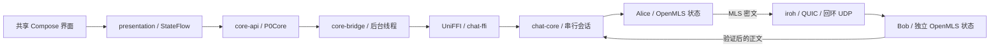

# P0 最小加密通信链路

日期：2026-10-18。当前范围：正式工程骨架，以及 Windows 本机双设备最小验证。完整 P0 的三端互操作、持久化和自托管网络验收仍有待办。

## 运行

在项目根目录打开 PowerShell：

```powershell
. .\tools\activate.ps1

# 打开真正的 Compose 桌面应用。
.\tools\run-desktop.ps1

# 一键测试、构建 Android APK、渲染界面并生成证据。
.\tools\verify-p0.ps1

# 只运行 Rust 最小链路。
cargo run --locked --offline -p chat-core --bin chat-p0
```

桌面界面中点击“连接两个设备”，选择 Alice 或 Bob，输入消息并发送。收到“已验证并解密”表示接收设备已真实处理 MLS 密文；P0 不使用正式 MVP 的“已接受/已送达”状态。

Windows 可在项目根目录双击 [`start-chat.cmd`](../start-chat.cmd) 一键启动同一 P0 桌面窗口；它调用 `tools/run-desktop.ps1`。窗口运行使用项目内临时目录装载 Skiko 原生库，避免系统临时目录不可用时启动失败。

构建任务自动生成 UniFFI 绑定和本机原生库，日常运行不需要手动复制 DLL。环境沿用 [依赖安装记录](DEPENDENCIES.md)。首次缺少缓存时需要联网安装构建插件/库；缓存完整后脚本默认离线运行。有意更新 Gradle 锁文件使用 `verify-p0.ps1 -RefreshLocks`。

## 实际链路与边界



两个设备目前处于同一 Rust 进程，但拥有独立签名密钥、OpenMLS provider、群状态、iroh EndpointId 与 UDP 端点。通信经过真实 QUIC 套接字，未使用内存队列替代传输。此实验验证库组合及跨语言链路，不等同两台物理设备或跨进程互操作。

建链顺序：

1. 生成两套临时 BasicCredential / Ed25519 签名密钥。
2. Bob 创建真实 KeyPackage，经 iroh 传到 Alice；Alice 验证 KeyPackage 签名及当前配对夹具中已知的凭据/签名公钥。
3. Alice 创建 MLS 群、添加 Bob、合并本地引导 pending Commit；Welcome 连同 ratchet-tree 扩展经 iroh 传给 Bob。
4. Bob 处理 Welcome，检查双方成员凭据、公钥、group ID 和 epoch authenticator 一致。
5. 发送方使用 MLS application message 加密，接收方从网络读入有界帧并执行 MLS 验证/解密，再将结果返回 Kotlin。

使用 OpenMLS 0.9.1 / RustCrypto 0.6.0，P0 套件为 `MLS_128_DHKEMX25519_AES128GCM_SHA256_Ed25519`。引导后 epoch 为 1。测试设备名不是产品账户身份；本机配对夹具的信任不替代主管账户签发、联系人核验、设备撤销或一次性 KeyPackage 服务。

iroh 1.3.0 使用 `presets::Minimal`，显式 `RelayMode::Disabled`、`clear_address_lookup()`、`PortmapperConfig::Disabled` 与 `NetReportConfig::minimal()`，清除默认 IP transports 后仅绑定 `127.0.0.1:0`。双方通过明确的 EndpointId + 回环地址连接，并检查连接对端身份。不启用公共中继/发现、UPnP/PCP/NAT-PMP 映射和可选公网探测，没有公网监听。

P0 使用独立 ALPN `chat/p0/mls/1`，帧为 magic/version/kind/长度/MLS 字节；整个帧最多 64 KiB，文本最多 8192 个 UTF-8 字节，解码拒绝错误版本、类型、截断和尾随字节。传输回复只是密文帧摘要，不是正式投递或协调节点回执。P0 不冻结 MVP 的签名日志编码。

## 正式模块的接入情况

| 层 | 当前实现 |
|---|---|
| Cargo workspace | 登记所有 `crates/*`、`apps/node`，保留 `tools/rust-dependency-check`，本地 path 依赖写入真实锁文件 |
| `crates/protocol` | P0 有界帧和文本限制，独立于正式协议草案 |
| `crates/crypto` | 临时设备、KeyPackage、Welcome、建群、应用消息、凭据绑定检查 |
| `crates/transport` | 本机真实 iroh/QUIC 双设备传输、对端绑定、超时与关闭 |
| `crates/core` | 串行编排、双向通信、会话失败锁定、幂等关闭、CLI |
| `crates/ffi` | 生成式 UniFFI 对象、简单 DTO、稳定输入错误与操作错误 |
| `shared/core-api` | 独立 P0 业务接口和结果 DTO，不冒用正式 ConversationService |
| `shared/core-bridge` | JVM/Android 绑定适配、IO 线程、串行访问、取消后的构造清理、原生释放 |
| `shared/presentation` | StateFlow 页面状态、忙碌互斥、错误、最多 100 条临时显示记录 |
| `shared/ui` | 共享 Compose 界面，宽屏/窄屏布局、双设备切换、实际解密内容 |
| `apps/desktop` | 可运行窗口、显式关闭、跨语言 smoke 与真实 Compose 离屏渲染任务 |
| `apps/android` | Activity、启动入口、INTERNET 权限、arm64 JNI 打包及共享页面 |
| `desktop/*`、插件示例 | Kotlin/JVM 工程与示例 JAR 构建；未实现插件安装/可信授权/宿主运行验收 |
| storage/identity/domain/sync/node | 客户端和节点另有独立文件 SQLite P0 事务实验；正式业务仍未实现，节点不会假报可用 |

主要入口：[Rust 编排](../crates/core/src/p0.rs)、[MLS](../crates/crypto/src/engine.rs)、[iroh](../crates/transport/src/network.rs)、[FFI](../crates/ffi/src/bridge.rs)、[Kotlin 桥接](../shared/core-bridge/src/jvmMain/kotlin/chat/bridge/NativeP0Core.kt)、[共享页面](../shared/ui/src/commonMain/kotlin/chat/ui/P0Screen.kt)。

## 线程、失败和资源释放

一个 P0 会话由一把 Rust mutex 串行推进 MLS 状态，Kotlin 桥接另有 coroutine mutex。JNA 阻塞调用运行在 `Dispatchers.IO`，不会直接占用 Compose UI 线程。Rust 初始化上限 30 秒，单次网络传输上限 10 秒，正常关闭上限 5 秒。

取消 Kotlin coroutine 不会抢占已经进入原生代码的同步操作；它可能已经完成发送/解密。构造取消会清理新建句柄，Kotlin close 路径使用 NonCancellable 执行原生 shutdown + destroy。UniFFI 对象生成的 AutoCloseable.close 保留用于句柄释放，原生业务方法避免使用相同名称。页面离开/窗口关闭会等待在途工作再释放资源；本原型不把取消解释为“消息肯定没有发送”。

验证输入之前不推进加密状态，空消息、超限和未知发送方可以修正后继续使用会话。发生网络/MLS 处理错误后会将当前会话标记为失败，禁止继续发送，必须重建；不能回滚并重用已消费密钥。

### 实测到的持久化阻断点

`tampered_foreign_group_and_wrong_identity_rejected` 用例发现：对有效 application message 的末字节进行篡改，OpenMLS 拒绝该密文后，默认内存 provider 可能已消费相应接收 secret，随后处理原始合法密文会报告 secret 已删除。测试保留了这一行为断言。

因此不能把 `process_message` 返回 Err 当作“没有状态副作用”。独立的 [P0-03 持久化实验](P0_PERSISTENCE.md) 已用同一 SQLite 事务和失败后重新加载群对象验证此路径：篡改密文出错后，原始合法密文可以在回滚/重启后解密。现有界面/iroh 会话仍使用内存 provider，尚未接入该实验；正式网络重试、可靠 outbox 和完整崩溃恢复未实现。

## 构建产物与结果

- Windows 原生库：`build/native/host/chat_ffi.dll`。
- Kotlin 绑定：`build/generated/chat-ffi/`，编译任务自动依赖生成任务。
- Android 原生库：`build/native/android/arm64-v8a/libchat_ffi.so`。
- Android 调试 APK：`apps/android/build/outputs/apk/debug/android-debug.apk`。
- Compose 真实渲染：`build/p0-snapshots/desktop.png`、`compact.png`，内容来自实际 MLS/iroh 解密结果。
- 一键验证记录：`docs/p0-validation-latest.json`；原始日志与 Rust 往返 JSON 位于 `build/p0-evidence/`。

实际检查 Windows PE imports 和 Android ELF NEEDED 后确认：iroh 代码以 Rust 库形式链接进 chat_ffi，其构建过程中额外生成的 iroh/iroh-relay cdylib 不是运行依赖。正式打包仅复制 chat_ffi；JNA 和 Compose 的 Android 原生库仍由对应 AAR 提供，避免将重复库打进 APK。

最新离线复跑：2026-10-18 14:56（Pacific/Auckland），`tools/verify-p0.ps1` 退出码 0，无需刷新锁文件。机器可读报告：[p0-validation-latest.json](p0-validation-latest.json)，包含当前 DLL、Android `.so` 和 APK 的 SHA-256；P0-03 崩溃日志位于 `build/p0-evidence/persistence-crash.log` 与 `node-acceptance.log`。根目录 `start-chat.cmd` 另行实际启动窗口，并在关闭后 `BUILD SUCCESSFUL`。

| 检查 | 实际结果 |
|---|---|
| 正式 Cargo workspace | 所有模块编译与测试通过；原有 6 项 P0 用例、7 项客户端持久化测试及 4 项节点接受测试通过 |
| MLS 用例 | 双向明文恢复、重放拒绝、篡改拒绝、异群拒绝、凭据绑定、重复 Welcome 拒绝 |
| 协议/核心用例 | 帧版本/类型/长度限制、UTF-8 输入上限、真实网络双向发送、并发串行化、幂等关闭 |
| Rust CLI | 独立执行真实 MLS/iroh 双向往返，结果 JSON 保存于 evidence 目录 |
| Kotlin 原生链路 | Alice → Bob 和 Bob → Alice 通过，错误映射、输入错误后继续使用和关闭后拒绝通过 |
| 共享界面 | 实际 Compose 离屏渲染 1024×860、390×844，两张图均已检查，内容来自真实解密结果 |
| Kotlin 工程骨架 | 共享模块、desktop platform/plugin SDK/host 和两个插件示例 JAR 构建通过 |
| Android arm64 | Rust ELF64/AArch64 构建、Kotlin 绑定编译和调试 APK 打包通过 |
| APK 核对 | dev.chat.p0 启动入口、arm64-v8a ABI、chat_ffi/JNA/Compose 原生库齐全；调试 v2 签名与 16 KiB ZIP 对齐验证通过 |
| 持久化局部实验 | T1/C01、T1→T2、发送/接收共 11 个进程 abort 断点；OpenMLS/SQLite 同事务、固定密文、拒绝/SQL 错误回滚；详情见 [P0-03 记录](P0_PERSISTENCE.md) |
| 节点接受局部实验 | 3 个进程 abort 断点；节点 SQLite 日志、head、投递任务原子提交，未知结果固定密文重试、冲突拒绝、并发连续序号及预先固定公钥的 P0 Ed25519 回执验证通过；详情见 [节点记录](P0_NODE_ACCEPTANCE.md) |
| DeepSeek 界面交付复核 | 展示层竞态检查、P0 与正式界面样例预览截图通过；真实链路和样例数据保持隔离，详见 [下一轮任务书](DEEPSEEK_WORK_PLAN.md) |
| 工程资料 | 197 个计划函数契约引用、模块路径、Markdown 链接、JSON/Schema/SQL 草案结构检查及 PowerShell 语法检查通过 |

APK 为调试产物，尚未做发布裁剪、安装体积或运行内存基线。上述 PASS 限于本表场景；不表示完整 P0、正式群日志、生产安全或三端真机互操作已经通过。

已连接真机时可自行执行：

```powershell
adb install -r apps/android/build/outputs/apk/debug/android-debug.apk
adb shell am start -n dev.chat.p0/chat.android.MainActivity
```

当前 `adb devices -l` 未列出测试设备。Linux 构建脚本已提供，但当前 Windows 环境不宣称通过 Linux 运行验证。

## 下一步 P0 顺序

1. 在 Android arm64 真机与 Linux x64 上运行绑定及 MLS/iroh 原型，并扩展到两台实际设备互通。
2. 将已通过的 SQLite 事务实验接入正式存储与网络链路，补齐正式 C01、C05/C07-C09、完整 C06、并发及断电故障矩阵（P0-03）。
3. 验证加密 SQLite、WAL/备份覆盖和系统密钥保护（P0-04）。
4. 接入可配置自托管 relay，验证跨 NAT 和完全关闭公共设施的网络矩阵（P0-05）。

完整验收仍以 [P0 清单](implementation/P0_CHECKLIST.md) 为准，本实验未完成的项目不勾选通过。
